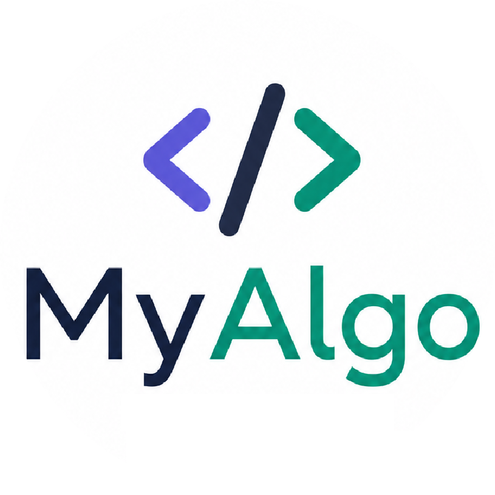

<div align="center">
  
  <h1>MyAlgo IDE</h1>
  <p><strong>بيئة تطوير ومحرر تفاعلي متكامل لتدريس وتعلم الخوارزميات</strong></p>
  <p><i>من تطوير: الأستاذ شرف أيمن (Aymen Chraf)</i></p>

  <p>
    
    
    
    
    
  </p>
</div>

<hr>

## 📖 عن المشروع (About)

**MyAlgo IDE** هو محرر وبيئة برمجية تعليمية متكاملة صُممت خصيصاً لمرافقة تلاميذ وأساتذة الطور الثانوي (والمبتدئين عموماً) في تدريس وتعلم مبادئ الخوارزميات وكتابتها بالصيغة الأكاديمية المعتمدة رسمياً في المناهج التعليمية الجزائرية (*Algorithmique en Français*).

يهدف البرنامج إلى تجسيد الخوارزمية النظرية المكتوبة على الورق إلى تطبيق عملي تفاعلي، مع إمكانية التنفيذ خطوة بخطوة وتتبع حالة الذاكرة وقيم المتغيرات لحظياً، وتقديم رسائل خطأ توجيهية باللغة العربية.

---

## ✨ المميزات الرئيسية (Features)

* 📝 **محرر كود ذكي (Code Editor):**
  * تلوين دلالي واحترافي للكلمات المحجوزة والأنواع والعمليات والنصوص.
  * ترقيم دقيق للأسطر مع شريط تمرير سليم ومنفصل تماماً عن مساحة الترقيم.
  * استقلالية تامة لحالة الأحرف (*Case-Insensitive*): يقبل `Fin` أو `fin` أو `FIN`.

* ⚡ **مساعد كتابة وإكمال تلقائي ذكي (IntelliSense Completer):**
  * اقتراح فوري للتعليمات، الكلمات المفتاحية، والمتغيرات/الثوابت المصرح عنها فور كتابة أول حرفين.
  * **ذكاء سياقي في اقتراح البنى:** لا يقترح قوالب البنى الكاملة إلا عند كتابة بداية الكلمة الافتتاحية (`si` تقترح بنية `Si ... Alors ... FinSi`، بينما كلمات المنتصف أو النهاية مثل `alors` أو `finsi` تقترح الكلمة فقط دون إدراج قوالب مكررة).
  * تصميم مدمج وأنيق مع رموز تصنيف ملونة وتصنيف عربي مقتضب.

* 📌 **مكتبة الكلمات المحجوزة ونظام التوثيق الفوري (Interactive Keywords Help):**
  * شريط جانبي يضم 37 كلمة محجوزة مرتبة ومصنفة.
  * **النقر بالزر الأيسر:** يُدرج الكلمة فوراً في المحرر عند موضع المؤشر.
  * **النقر بالزر الأيمن:** يفتح نافذة توثيق وشرح بيداغوجي غنية تضم:
    * شرحاً تفصيلياً مبسطاً باللغة العربية لوظيفة التعليمة.
    * الصيغة العامة (*Syntaxe*) مع تلوين الأكواد.
    * مثالاً تطبيقياً كاملاً مع تلوين دلالي (*Syntax Highlighting*).
    * إضاءة ونصائح تعليمية لتفادي أخطاء المبتدئين الشائعة.
    * إمكانية نسخ كود المثال أو إدراجه مباشرة في المحرر بضغطة زر.

* 🧠 **جدول تتبع الذاكرة الحية (Memory Tracker):**
  * تتبع قيم المتغيرات وأنواعها وحالاتها في الذاكرة لحظة بلحظة أثناء التنفيذ.

* ⚙️ **تنفيذ تفاعلي مرن (Execution Engine):**
  * **تشغيل كامل (F5):** تنفيذ الخوارزمية كاملة وعرض المخرجات وقراءة المدخلات في الكونسول.
  * **تنفيذ خطوة بخطوة (F6):** إمكانية تتبع مسار البرنامج سطراً بسطر مع وميض وإبراز السطر النشط.

* 🛡️ **معالجة متقدمة للأخطاء (Bilingual BiDi Error Engine):**
  * رسائل أخطاء واضحة بيداغوجياً باللغة العربية مع توجيهات وحلول مقترحة.
  * فصل دقيق بين اتجاه النص العربي (RTL) والأكواد المقتبسة وأسهم الإسناد `<-` والفواصل (LTR) لمنع تداخل الأحرف والرموز.

---

## 🏗️ هيكلية المشروع (Architecture)

```text
MyAlgo/
├── main.py              # الواجهة الرسومية الرئيسية وإدارة دورة حياة التطبيق
├── transpiler.py        # محرك التحليل والتحويل والتنفيذ المتدرج
├── completer.py         # محرك ومفوّض الإكمال التلقائي الذكي (IntelliSense)
├── keyword_help.py      # التوثيق البيداغوجي الشامل ونافذة الشرح التفاعلية
├── highlighter.py       # ملوّن الشيفرات المصدرية الدلالي (AlgoHighlighter)
├── grammar.lark         # القواعد النحوية الرسمية للغة الخوارزميات (Lark Grammar)
├── fonts/               # خطوط الواجهة المدمجة (Cairo و JetBrains Mono)
├── img/                 # شعارات وأيقونات البرنامج الرسمية
├── build/               # ملفات بناء الحزم المؤقتة
└── dist/                # المجلد الناتج الذي يحوي ملف MyAlgo.exe المستقل
```

---

## 🛠️ التقنيات المستخدمة (Tech Stack)

* **[Python 3](https://www.python.org/):** اللغة الأساسية للمشروع.
* **[PyQt6](https://pypi.org/project/PyQt6/):** لبناء واجهة المستخدم الرسومية المتطورة.
* **[Lark Parsing](https://lark-parser.readthedocs.io/):** محرك التحليل النحوي وبناء شجرة الإعراب (*AST & Parser*).
* **[PyInstaller](https://pyinstaller.org/):** لتجميع وحزم التطبيق كملف تنفيذي مستقل بذاته.

---

## 🚀 طريقة التشغيل (How to Run)

### 1. للمستخدم العادي (تشغيل فوري على Windows)
لا حاجة لتثبيت بايثون أو أي مكتبات إضافية. حمّل ملف **`MyAlgo.exe`** مباشرة من مجلد `dist/` أو من قسم **Releases**، وانقر عليه مرتين للبدء فوراً.

### 2. للمطورين والأساتذة (التشغيل من الكود المصدري)

```bash
# 1. استنساخ المستودع
git clone https://github.com/aymenchraf/MyAlgo.git
cd MyAlgo

# 2. إنشاء بيئة افتراضية وتفعيلها
python -m venv .venv
.venv\Scripts\activate

# 3. تثبيت الاعتماديات المطلوبة
pip install PyQt6 lark

# 4. تشغيل البرنامج
python main.py
```

### 3. بناء ملف تنفيذي (.exe) جديد

إذا قمت بأي تعديلات وترغب في توليد ملف تنفيذي موحد:

```bash
.venv\Scripts\pyinstaller.exe --noconsole --onefile --clean --name "MyAlgo" --icon "img\icon.ico" --add-data "img;img" --add-data "fonts;fonts" --add-data "grammar.lark;." --collect-all lark main.py
```

---

## 📜 مثال لخوارزمية مدعومة

```text
Algorithme CalculSomme;
Variable
    x, y, S : entier;
Début
    Ecrire("أدخل العدد الأول:");
    Lire(x);
    Ecrire("أدخل العدد الثاني:");
    Lire(y);
    S <- x + y;
    Ecrire("المجموع هو: ", S);
Fin
```

---

## 📬 التواصل والدعم البيداغوجي

لأي استفسار، ملاحظات تربوية، أو اقتراح ميزات جديدة، يسعدنا تواصلكم عبر البريد الإلكتروني:  
📧 **aymen.chraf@gmail.com**

---

<div align="center">
  <b>MyAlgo IDE — الإصدار 1.0 المستقر</b><br>
  صُنع بشغف لتطوير تعليم مادة الإعلام الآلي والخوارزميات 🇩🇿
</div>
